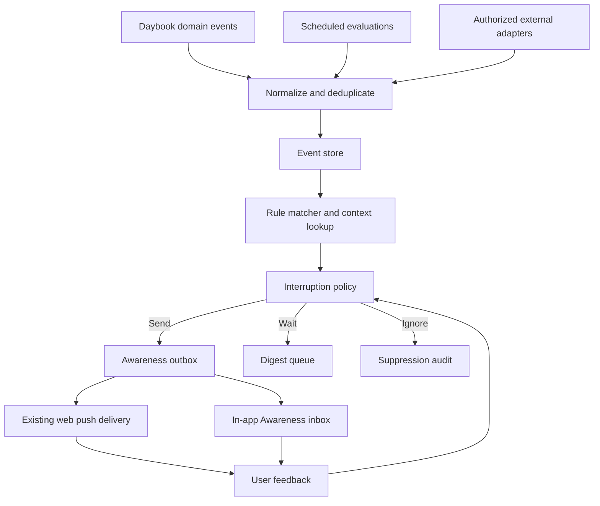

# Daybook Awareness Engine — Product and Technical Specification

**Status:** Proposal / design only  
**Target:** Daybook `notes-server`  
**Scope:** Proactive, user-controlled prompts based on authorized activity signals.  
**Non-goal:** Continuous surveillance or an autonomous agent that acts without consent.

## 1. Problem and product promise

Daybook currently responds to user-initiated notes, requests, reminders, and scheduled briefings. A proactive system should detect relevant changes and prompt the user when action or reflection would be useful, without requiring them to ask.

**Promise:** “Daybook notices what matters, remembers why, and reaches out at the right time.”

The critical product metric is **useful interventions per interruption**, not notification volume.

### Example journeys

1. **Deferred commitment:** A task is postponed three times. Daybook asks whether to reschedule, break it down, or archive it.
2. **Upcoming obligation:** An event is approaching and a linked task is unfinished. Daybook prompts at a configurable lead time.
3. **Morning context:** Today's calendar and overdue tasks are synthesized into one digest, avoiding duplicate notifications.
4. **Relevant external event (later):** An authorized GitHub webhook reports a failed CI run on a PR the user follows; Daybook offers a short summary.
5. **Location trigger (later, opt-in):** A native/Shortcuts geofence signal matches a user-created errand. Daybook offers the errand details. A PWA alone must not promise continuous background location.

## 2. Principles and constraints

- **Opt-in by signal source.** Default to Daybook-native task/reminder activity and time-based checks. External providers require separate consent.
- **Permission boundaries.** Ingest only explicitly authorized sources and scopes. Never silently collect screen contents, microphone, browser history, or precise location.
- **Deterministic decisions first.** Rule-based eligibility, throttling, and suppression; optional AI for summarization and relevance with citations, not for bypassing policy.
- **Explainability.** Every suggestion displays “Why am I seeing this?” with underlying events/notes and allows dismiss, snooze, mute rule/source.
- **Non-interruption is a first-class outcome.** Suppress low-confidence, repetitive, stale, and out-of-hours prompts.
- **Storage portability.** The awareness domain model must not depend on GitHub-backed vs in-app storage; isolate adapters.
- **Reuse current capabilities.** Integrate with existing task IDs, reminder delivery, web push, weekly review, briefings, and scheduled execution; do not create a competing notification stack.
- **Privacy and reliability.** No personal content in logs by default; idempotent event ingestion, safe retries, bounded retention, no cross-user leakage.
- **Do not change repo/deployment settings without approval.** This PR is documentation only.

## 3. Functional scope

### v1 — native awareness

- Ingest Daybook events: `task.created`, `task.updated`, `task.completed`, `task.deferred`, `reminder.due`, `note.created` (metadata only by default), and `goal.updated` when goals are represented.
- Scheduled evaluation for overdue tasks, repeated deferrals, upcoming deadlines, and daily briefing candidates.
- Associate candidate prompts with a task, note, or explicit user goal; do not invent a goal.
- Produce a candidate with reason, references, urgency, expiration, and suggested actions.
- Enforce preferences, quiet hours, frequency caps, deduplication, and cooldown.
- Deliver via existing web push (where enabled) or persist to an in-app Awareness inbox. Notification permission is optional.
- Capture `opened`, `acted`, `dismissed`, `snoozed`, `muted` outcomes.
- Include controls to pause awareness, disable individual signal categories, and inspect/delete activity history.

### v1.1 — calendar and integrations

- Calendar signals for events/changes with explicit authorization, via supported sync mechanisms.
- Apple Reminders sync signals using the existing integration; distinguish imported state changes from user actions to prevent loops.
- GitHub webhook adapter for followed PRs/issues and CI status; validate webhook signatures and minimize retained payload.
- Provider email connectors only after clear scopes, privacy review, and secure token storage.

### Later

- Optional Shortcuts/native location events, with granular consent and a clearly visible opt-out.
- Personalized relevance ranking learned from explicit outcomes, with explainable controls.
- Multi-device delivery preferences and notification-channel routing.
- Agent-proposed plans and edits requiring confirmation for consequential actions.

## 4. Architecture



**Component contracts:**

- **Signal adapters:** Translate native hooks, scheduled checks, and future provider webhooks to a common event schema; adapters never send notifications directly.
- **Event store:** Durable, per-owner records with unique event IDs, source references, timestamps, and retention metadata.
- **Context resolver:** Fetch minimum necessary notes/tasks/goals, honoring permissions. Store references rather than duplicating sensitive note bodies.
- **Rule engine:** Emit candidates only when evidence and actionability thresholds are met.
- **Interruption policy:** Apply user preferences, severity, quiet hours, cooldowns, per-day budgets, duplicate checks, and existing briefing/reminder schedules.
- **Outbox/delivery:** Use existing notification delivery and retries. Delivery failure does not erase the in-app candidate.
- **Feedback:** Record explicit outcome; do not interpret a lack of interaction as consent for more alerts.

### Proposed interfaces (illustrative; not implemented)

```ts
type AwarenessEvent = {
  id: string;                 // idempotency key
  ownerId: string;            // scoped tenant/owner identifier
  type: string;               // e.g. task.deferred
  source: "daybook" | "schedule" | "apple-reminders" | "calendar" | "github";
  occurredAt: string;         // ISO-8601
  observedAt: string;
  subjectRef?: { kind: "task" | "note" | "event" | "goal"; id: string };
  metadata: Record<string, unknown>; // allowlisted, bounded, no raw secrets
};

type AwarenessCandidate = {
  id: string;
  ownerId: string;
  ruleId: string;
  evidenceEventIds: string[];
  subjectRefs: Array<{ kind: string; id: string }>;
  reason: string;             // human-readable, grounded explanation
  suggestedActions: Array<"open" | "snooze" | "reschedule" | "dismiss">;
  urgency: "low" | "normal" | "high";
  createdAt: string;
  expiresAt: string;
  dedupeKey: string;
};

type AwarenessDecision =
  | { disposition: "send"; channel: "push" | "inbox" }
  | { disposition: "digest"; nextEligibleAt: string }
  | { disposition: "suppress"; reason: string };
```

Example event:

```json
{
  "id": "task-123:defer:3",
  "ownerId": "notes-owner",
  "type": "task.deferred",
  "source": "daybook",
  "occurredAt": "2026-10-13T14:00:00Z",
  "observedAt": "2026-10-13T14:00:01Z",
  "subjectRef": { "kind": "task", "id": "task-123" },
  "metadata": { "deferCount": 3 }
}
```

### Persistence

Start with the project's existing storage and scheduler patterns after an implementation audit. Proposed logical collections (not necessarily separate databases): `awareness_events`, `awareness_candidates`, `awareness_preferences`, `awareness_delivery_outbox`, `awareness_feedback`. Use a transactional or idempotent outbox design compatible with the actual Cloudflare storage bindings. Do not assume a queue, D1 database, or Durable Object exists until verified.

Required indexes/keys: owner + event ID, owner + timestamp, owner + dedupe key, owner + next eligible delivery. Retention defaults to a short bounded window for raw events (proposed 30 days) and longer user-configurable history for delivered prompts (proposed 90 days); validate against backup/export and privacy expectations before implementation.

## 5. Interruption policy

Proposed initial defaults, to validate in beta:

- **Awareness mode:** Quiet / Balanced (default) / Active.
- **Quiet hours:** 22:00–08:00 in the user's configured timezone. Normal prompts defer; urgent exceptions only for user-authorized critical categories.
- **Budget:** Balanced: maximum two proactive pushes per day, excluding explicitly scheduled reminders; aggregate others into the existing briefing or inbox.
- **Cooldown:** 24 hours per task/rule combination after a prompt; 7 days after dismissal unless the user changes the task or urgency materially changes.
- **Confidence:** Native rule matches require objective evidence (e.g., defer count, due date). AI-generated interpretation never alone authorizes a push.
- **Priority:** User-scheduled reminders and user-defined deadlines outrank inferred suggestions.
- **Fallback:** If push is not enabled, save to inbox and optionally include in next briefing. Never force notification permissions.
- **Staleness:** Revalidate task status and due date immediately before delivery; cancel prompts about completed/deleted tasks.

Rule evaluation order: validate event and owner → match rule → resolve authorized context → create candidate → recheck current state → apply user policy → dedupe → persist outbox decision → deliver → record outcome.

## 6. UX requirements

### Awareness inbox

- Show actionable suggestions with date, evidence, and clear actions.
- “Why this?” reveals source task/note/event and rule, with navigable links.
- Dismiss, snooze, turn off this suggestion type, and pause all awareness.
- Separate scheduled reminders from inferred nudges.
- Show delivery state and a way to retry notification permission setup.

### Settings

- Awareness on/off; Quiet/Balanced/Active; quiet hours; push budget.
- Per-source toggles (Daybook tasks, notes/patterns, calendar, external apps, optional location).
- Permissions screen shows connected source, granted scope, last sync, disconnect, and data deletion options.
- Explicitly state which features require mobile OS integrations and which work in PWA.

### Notification content

- Short, contextual, non-sensitive on lock screen by default: e.g. “Daybook has a suggestion about an unfinished task.”
- Full explanation inside authenticated app; opt-in to more detailed previews.
- Actions are suggestions; editing tasks or sending external messages requires explicit user approval.

## 7. API and security proposal

Candidate authenticated routes (final naming subject to current router conventions):

- `GET /app/api/awareness/preferences`
- `PUT /app/api/awareness/preferences`
- `GET /app/api/awareness/inbox?cursor=...`
- `POST /app/api/awareness/:id/feedback`
- `GET /app/api/awareness/history`
- `DELETE /app/api/awareness/history`

All routes require existing session auth and same-origin/CSRF protection for mutations. Do not expose activity or notification history via unauthenticated MCP resources. For external webhooks, verify provider signature, replay protection, scope to configured account, and limit payload size. Apply input validation, per-owner isolation, rate limiting, and redaction. Use existing secret management; no tokens in events, logs, or notification bodies.

## 8. Implementation phases

**Phase 0 — Audit and test design**
- Inventory actual scheduler, storage adapters, task mutations, briefing logic, web push, Apple sync, and authorization paths.
- Confirm event hook points, notification suppression opportunities, and existing test patterns.
- Write acceptance tests before introducing storage or new bindings.

**Phase 1 — First vertical slice**
- Add `task.deferred` event and idempotent persistence.
- Implement “three deferrals” rule, 24h cooldown, and completion recheck.
- Persist candidate in Awareness inbox; no push required.
- Add user dismissal and rule mute.

**Phase 2 — Safe outbound prompting**
- Add preference UI, quiet hours, frequency cap, and push opt-in integration.
- Reuse existing web push and briefing scheduling.
- Record delivery/feedback and handle retry/expiration.
- Add upcoming deadline and overdue task rules.

**Phase 3 — External signal adapters**
- Integrate calendar and Apple Reminders state changes, then GitHub webhooks.
- Add authorization, webhook verification, source disconnect, data deletion.
- Consider email/location only after separate privacy and platform feasibility reviews.

**Phase 4 — Optional intelligence**
- Context-grounded summaries and candidate explanations with linked evidence.
- Personalization based on explicit feedback; benchmark precision and interruption burden.
- No AI-initiated high-impact actions without confirmation.

## 9. Test and acceptance criteria

Unit tests:
- Duplicate events processed once; reordered and delayed events handled safely.
- Completed/deleted tasks never trigger stale nudges.
- Timezone/DST boundaries, quiet hours, caps, cooldown, snooze, and mute.
- External-source disabled → no ingest or delivery; source revocation stops future events.
- Two simultaneous scheduler runs do not double-send.
- Malformed/oversized events rejected; sensitive payloads excluded from logs.

Integration tests:
- A task deferred three times yields exactly one candidate with correct evidence.
- In-app inbox works with push disabled.
- Push enabled delivers through existing channel once and records result.
- Existing scheduled reminders and briefings continue unchanged.
- Existing storage modes produce equivalent outcomes.
- User history deletion removes awareness artifacts without deleting original notes/tasks.

Browser tests (Playwright):
- Settings toggles persist and are accessible on iPhone-sized viewport.
- Inbox displays “Why this?”, dismiss, snooze, mute, and actionable navigation.
- Notification permission denial is handled gracefully.

Pilot acceptance (targets, not guarantees):
- 5 fresh users; 4+ can understand/adjust awareness settings unaided.
- Zero duplicate proactive pushes in test scenarios.
- At least 70% of delivered suggestions judged relevant by pilot feedback.
- Fewer than 10% marked “too many notifications.”
- All awareness features remain useful with push disabled.

## 10. Open decisions

1. Should the v1 inbox be a dedicated Awareness view or part of Today?
2. Are task deferrals represented as first-class state transitions today, or must they be derived from history?
3. What durable store and scheduled trigger semantics exist in each deployment mode?
4. Should all prompts be visible in a daily digest even when push is suppressed?
5. What are the privacy and export implications of retaining inferred patterns?
6. What should be the default retention and user-facing deletion controls?

## 11. Explicitly out of scope for this PR

No application behavior changes, dependency additions, Cloudflare bindings, schema migrations, deployment modifications, repository settings, or automatic access to external accounts. This PR exists to review and approve the design before implementation.
